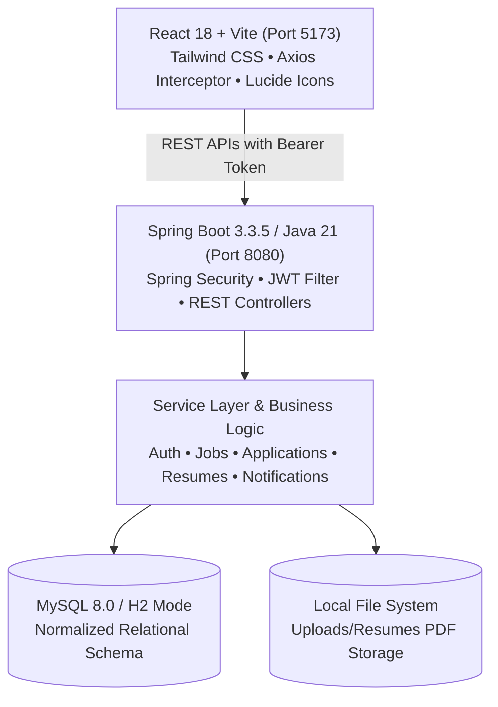

# JobConnect – Online Job Portal & Recruitment Management System

[](https://www.oracle.com/java/)
[](https://spring.io/projects/spring-boot)
[](https://spring.io/projects/spring-security)
[](https://jwt.io/)
[](https://reactjs.org/)
[](https://vitejs.dev/)
[](https://tailwindcss.com/)
[](https://www.mysql.com/)
[](http://localhost:8080/swagger-ui.html)

**JobConnect** is an enterprise-grade full-stack Online Job Portal and Recruitment Management System engineered for software developers, talent acquisition teams, and platform administrators. Built with a robust **Java 21 / Spring Boot 3** backend and a responsive **React 18 / Vite / Tailwind CSS** frontend.

---

## 🌟 Key Application Features

### 1. Public & Core Experience
- **Interactive Landing Page**: Modern SaaS design with live multi-parameter job search, category discovery pills, real-time statistics counters, and featured opportunities.
- **Advanced Job Search & Filtering**: Instant search across keywords, tech skills, location, employment type (`FULL_TIME`, `PART_TIME`, `CONTRACT`, `INTERNSHIP`, `REMOTE`), and min/max salary sliders.
- **Job Details View**: Comprehensive specifications including role overview, key responsibilities, qualifications, required skills badges, hiring company branding, and deadline tracking.
- **Authentication & Authorization**: Stateless JWT Bearer token authentication with BCrypt password hashing and role-based access control (RBAC).
- **One-Click Demo Login**: Quick-fill buttons on the login screen to instantly explore as Job Seeker, Recruiter, or Admin.

### 2. Job Seeker Experience
- **Candidate Dashboard**: Visual metrics tracking Total Applications, Under Review, Shortlisted, and Interview Scheduled counts.
- **Rich Technical Profile**: Manage headline, bio, experience years, education, current company, skills tags, portfolio, GitHub, and LinkedIn links.
- **Resume Management**: Drag-and-drop PDF resume uploader, validation, preview, and download. Automatically attaches to job applications.
- **Application History**: Filterable application timeline with live status updates, cover letter records, and recruiter feedback notes.

### 3. Recruiter / Employer Experience
- **Recruiter Dashboard**: Headcount analytics, active job postings counter, total applicants pipeline, and quick applicant review shortcuts.
- **Job Posting Management**: Full CRUD capabilities to post, edit, toggle active/closed status, and delete job openings.
- **Applicant Review Pipeline**: Filter candidates by job opening and recruitment stage (`APPLIED`, `UNDER_REVIEW`, `SHORTLISTED`, `INTERVIEW_SCHEDULED`, `ACCEPTED`, `REJECTED`).
- **Resume Inspection**: 1-click download and preview of candidate PDF resumes directly from the reviewer console.
- **Stage Progression & Feedback**: Transition candidate status with personalized interview schedule details or feedback notes.

### 4. Admin Governance
- **System Analytics**: Platform-wide metrics including total registered users, active job count, application pipeline distribution, and jobs by employment type.
- **User Management**: Search and filter all members, activate/deactivate accounts, and delete non-compliant users.
- **Job Moderation**: Inspect all job postings across all organizations and moderate/remove inappropriate listings.
- **Application Audit Log**: Real-time audit trail of all candidate submissions across the entire system.

### 5. Automated Notifications
- **In-App Real-Time Alerts**: Dropdown notification center with unread badge counter for status updates and new applicant alerts.
- **Async Email Notifications**: Asynchronous email delivery on status changes and new applicant submissions.

---

## 🏗️ System Architecture



---

## 🗄️ Database Schema & Normalization

The database is structured in 3rd Normal Form (3NF) with explicit constraints and foreign keys:

- `roles`: `id`, `name` (`ROLE_ADMIN`, `ROLE_RECRUITER`, `ROLE_JOB_SEEKER`)
- `users`: `id`, `email` (unique), `password` (BCrypt), `first_name`, `last_name`, `phone`, `role_id`, `is_active`, `created_at`, `updated_at`
- `job_seekers`: `id`, `user_id` (FK), `headline`, `bio`, `experience_years`, `education`, `skills`, `resume_url`, `location`
- `recruiters`: `id`, `user_id` (FK), `company_name`, `company_website`, `company_logo`, `industry`, `location`, `designation`
- `jobs`: `id`, `recruiter_id` (FK), `title`, `description`, `requirements`, `responsibilities`, `job_type`, `location`, `salary_min`, `salary_max`, `skills_required`, `status`, `vacancies`, `application_deadline`
- `applications`: `id`, `job_id` (FK), `job_seeker_id` (FK), `cover_letter`, `resume_url`, `status`, `notes`, `applied_at` (Unique: `job_id` + `job_seeker_id`)
- `resumes`: `id`, `job_seeker_id` (FK), `file_name`, `original_name`, `file_type`, `file_size`, `file_download_uri`, `uploaded_at`
- `notifications`: `id`, `user_id` (FK), `title`, `message`, `is_read`, `type`, `created_at`

DDL script available at: `database/schema.sql`  
Seed script available at: `database/data.sql`

---

## 🔑 Pre-Configured Demo Credentials

The database automatically seeds the following verified accounts on startup:

| Role | Email | Password | Description |
| :--- | :--- | :--- | :--- |
| **JOB_SEEKER** | `seeker@gmail.com` | `seeker123` | Senior Full Stack Engineer (Alex Morgan) |
| **JOB_SEEKER** | `priya.sharma@example.com` | `seeker123` | Lead Frontend Architect (Priya Sharma) |
| **RECRUITER** | `recruiter@techcorp.com` | `recruiter123` | TechCorp Global (Sarah Jenkins) |
| **RECRUITER** | `talent@cloudnexus.io` | `recruiter123` | CloudNexus Labs (Marcus Vance) |
| **ADMIN** | `admin@jobconnect.com` | `admin123` | System Administrator |

---

## 📡 REST API Reference

Swagger UI is available at: **`http://localhost:8080/swagger-ui.html`**  
OpenAPI JSON Docs: **`http://localhost:8080/v3/api-docs`**

### Authentication
- `POST /api/auth/login`: Authenticate credentials & return JWT bearer token.
- `POST /api/auth/register`: Register new `JOB_SEEKER` or `RECRUITER`.

### Job Postings
- `GET /api/jobs`: Search & filter active jobs with pagination.
- `GET /api/jobs/{id}`: Detailed job specifications and applicant status.
- `GET /api/jobs/featured`: Top recent jobs for landing page.
- `POST /api/jobs`: Create new job vacancy (*Recruiter / Admin*).
- `PUT /api/jobs/{id}`: Update job posting (*Recruiter / Admin*).
- `DELETE /api/jobs/{id}`: Delete job posting (*Recruiter / Admin*).
- `PATCH /api/jobs/{id}/status`: Toggle job status (`ACTIVE` / `CLOSED`).
- `GET /api/jobs/recruiter/my-jobs`: List jobs posted by logged-in recruiter.

### Applications & Review
- `POST /api/applications/apply`: Submit candidate application (*Job Seeker*).
- `GET /api/applications/my-applications`: Candidate application history (*Job Seeker*).
- `GET /api/applications/recruiter`: Review candidates with job & stage filters (*Recruiter*).
- `GET /api/applications/{id}`: View full application submission.
- `PATCH /api/applications/{id}/status`: Update candidate stage & recruiter notes (*Recruiter*).

### Resumes & Files
- `POST /api/jobseekers/resume`: Upload PDF resume document (*Job Seeker*).
- `GET /api/jobseekers/resumes`: List candidate uploaded resumes.
- `GET /api/files/resume/{fileName}`: Download or inline preview candidate PDF resume.

### Candidate & Recruiter Profiles
- `GET /api/jobseekers/profile`: Current candidate profile.
- `PUT /api/jobseekers/profile`: Update candidate technical bio and skills.
- `GET /api/recruiters/profile`: Current employer profile.
- `PUT /api/recruiters/profile`: Update company logo, website, and industry.
- `GET /api/recruiters/dashboard`: Recruiter pipeline summary stats.

### Admin Console
- `GET /api/admin/dashboard`: Platform-wide analytics breakdown.
- `GET /api/admin/users`: Search, filter, and paginate platform users.
- `PATCH /api/admin/users/{id}/status`: Toggle user account active/suspended state.
- `DELETE /api/admin/users/{id}`: Permanently delete user.
- `GET /api/admin/jobs`: System-wide job listings for moderation.
- `DELETE /api/admin/jobs/{id}`: Remove inappropriate job posting.
- `GET /api/admin/applications`: Global application audit trail.

---

## 🚀 Setup & Execution Instructions

### Prerequisites
- **Java 21 LTS** or higher (`java -version`)
- **Maven 3.8+** (`mvn -version`)
- **Node.js 18+** & **npm** (`node -v`, `npm -v`)
- **MySQL 8.0** (Optional - in-memory MySQL-compatible dev profile runs out-of-the-box with zero setup)

---

### Step 1: Database Setup (MySQL)

#### Option A: Live MySQL 8.0 Server
1. Start your local MySQL service.
2. Create the database and import schema:
   ```bash
   mysql -u root -p < database/schema.sql
   mysql -u root -p < database/data.sql
   ```
3. Update connection credentials in `backend/src/main/resources/application-mysql.properties` if your password differs from `root`.
4. Run the backend with the `mysql` profile:
   ```bash
   mvn spring-boot:run -Dspring-boot.run.profiles=mysql
   ```

#### Option B: Embedded In-Memory Dev Database (Instant Start)
The backend comes pre-configured with a MySQL-compatible in-memory database (`dev` profile) that auto-populates all seed data, tables, users, jobs, and applications on boot. No manual database configuration required!

---

### Step 2: Running the Spring Boot Backend

```bash
cd backend
mvn clean compile
mvn spring-boot:run
```

The backend server starts at **`http://localhost:8080`**.  
Swagger API Docs will be live at: **`http://localhost:8080/swagger-ui.html`**.

---

### Step 3: Running the React Frontend

```bash
cd frontend
npm install
npm run dev
```

The frontend client starts at **`http://localhost:5173`**.  
The Vite dev server proxies all `/api` requests seamlessly to the backend on `http://localhost:8080`.

To build the optimized production bundle:
```bash
cd frontend
npm run build
```

---

## 📂 Project Structure

```
jobconnect/
├── backend/
│   ├── src/main/java/com/jobconnect/
│   │   ├── config/             # SecurityConfig, SwaggerConfig, WebConfig
│   │   ├── controller/         # REST Controllers (Auth, Jobs, Applications, Admin, etc.)
│   │   ├── dto/                # Request & Response DTOs, API & Paged Envelopes
│   │   ├── entity/             # JPA Entities (User, Role, Job, Application, Recruiter, etc.)
│   │   ├── exception/          # Custom Exceptions & GlobalExceptionHandler
│   │   ├── repository/         # Spring Data JPA Repositories
│   │   ├── security/           # JWT Utils, Filter, CustomUserDetails & Service
│   │   ├── service/            # Business Logic Interfaces & Implementations
│   │   ├── util/               # DataInitializer with demo seed data
│   │   └── JobConnectApplication.java
│   ├── src/main/resources/
│   │   ├── application.properties
│   │   └── application-mysql.properties
│   ├── uploads/resumes/        # Stored PDF resumes
│   └── pom.xml
├── frontend/
│   ├── src/
│   │   ├── api/                # Axios Client with JWT Interceptors & Service callers
│   │   ├── components/         # Navbar, Footer, ProtectedRoute, JobCard, Modals, Badges
│   │   ├── context/            # AuthContext (JWT & state), NotificationContext (alerts)
│   │   ├── pages/              # Public, Seeker, Recruiter, Admin pages
│   │   ├── App.jsx             # Router & Role Route Guards
│   │   ├── index.css           # Tailwind base styles & custom scrollbars
│   │   └── main.jsx
│   ├── package.json
│   ├── tailwind.config.js
│   └── vite.config.js
├── database/
│   ├── schema.sql              # Normalized MySQL DDL script
│   └── data.sql                # Seed data script
└── README.md
```

---

## 🛡️ Security Features
- **Stateless JWT Authentication**: Tokens signed with HMAC-SHA512 with 24-hour expiration.
- **Granular Authorization**: Role-based endpoint guards (`ROLE_ADMIN`, `ROLE_RECRUITER`, `ROLE_JOB_SEEKER`) via `@PreAuthorize`.
- **BCrypt Encryption**: Passwords salted and hashed with BCrypt (10 rounds).
- **CORS Configured**: Secure cross-origin resource sharing allowing frontend communication.
- **Resume Upload Sanitization**: Filename normalization, path traversal blocking (`..`), and PDF/DOC extension enforcement.

---

## 👨‍💻 Portfolio & Resume Highlights
- **Full-Stack Proficiency**: Seamless integration between Java 21 Spring Boot 3 microservices and modern React 18 SPA.
- **Production Architecture**: Layered architecture (Controller-Service-Repository), standard DTO envelopes, unified error handling, and transactional database integrity.
- **Clean SaaS UI/UX**: Designed with professional typography, custom badges, responsive mobile/desktop layouts, and interactive loading & empty states.

=======
# jobconnect
